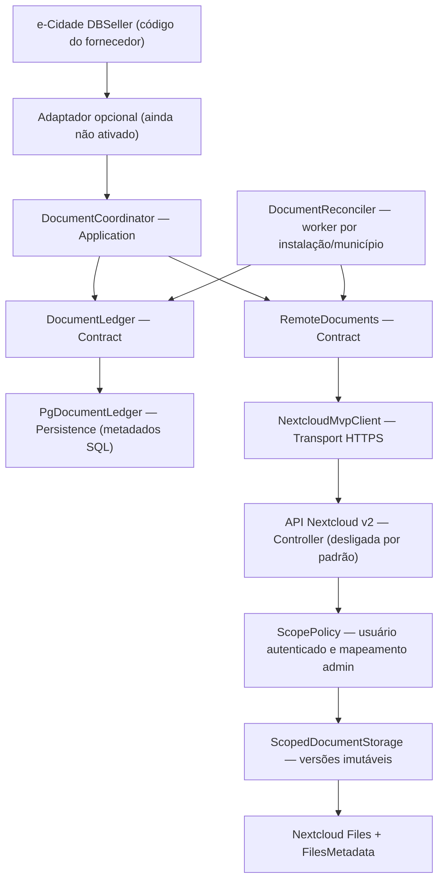

<!--
SPDX-FileCopyrightText: 2026 LibreCode coop and contributors
SPDX-License-Identifier: AGPL-3.0-or-later
-->

# MVP experimental — arquitetura por contratos e segurança transacional

Este documento descreve **código-fonte para avaliação**, não um serviço instalado. Todos os componentes são opt-in e **nenhum recurso é habilitado automaticamente**.

## Fluxo de dependências

Namespaces PHP:

| Camada | Namespace | Responsabilidade |
|---|---|---|
| Domínio | `ECidade\Nextcloud\Domain` | `Scope`, `OperationKey` |
| Contratos | `ECidade\Nextcloud\Contract` | journal, transporte de documentos |
| Aplicação | `ECidade\Nextcloud\Application` | coordenação, reconciliação, ponte sintética |
| Persistência | `ECidade\Nextcloud\Persistence` | somente metadados/referências em PostgreSQL |
| Transporte | `ECidade\Nextcloud\Transport` | HTTP(S) para Nextcloud |
| App servidor | `OCA\EcidadeLab\Controller`, `OCA\EcidadeLab\Service` | autorização Nextcloud, arquivos e metadados |

Não há acoplamento a um fornecedor no núcleo. O módulo da distribuição é uma fachada compatível com a interface do seu fork. **Os novos mecanismos não substituem a PoC nem a classe do ERP automaticamente.**

## Gravação com falhas recuperáveis

1. Uma transação empresarial ativa solicita uma referência via `DocumentCoordinator::reserve()`. O PostgreSQL grava apenas uma referência OID sintética, `document_key` e metadados.
2. Um `operation_key` aleatório identifica **uma versão imutável**. `RemoteDocuments::stage()` grava os bytes no Nextcloud, mas não os expõe a leitores comuns.
3. `PgDocumentLedger::recordStaged()` grava a intenção na **mesma transação SQL empresarial**. Se ocorrer `ROLLBACK`, a operação não será visível ao worker. O arquivo provisório remoto poderá ser descartado posteriormente, mediante período mínimo e verificação.
4. Após `COMMIT`, `DocumentReconciler` vinculado ao escopo autenticado seleciona um item do outbox confirmado por SQL, chama `finalize()` idempotente e confirma a revisão.
5. `DocumentCoordinator::read()` recupera somente versão confirmada e verifica SHA-256 e tamanho. Falhas geram erros explícitos; não há fallback silencioso aos Large Objects nativos.

**A leitura de um arquivo ainda não reconciliado falha.** Essa diferença semântica em relação ao e-Cidade legado é uma pendência de integração, não uma melhoria transparente. O fornecedor precisa verificar cada fluxo que lê um arquivo imediatamente após gravá-lo.

## Exclusão segura

A transação SQL cria uma marca de exclusão; **não exclui os bytes remotamente**. Versões anteriores são preservadas para recuperação e para a política posterior de retenção. A decisão sobre exclusão física dependerá de regras administrativas, fiscais e documentais.

## IDs e legado

O novo ID lógico de 32 bits é independente do ID de arquivo Nextcloud e reservado em um intervalo alto de teste, com consulta ao catálogo dos Large Objects existentes. A sequência **não é uma estratégia suficiente para produção** sem inventário e garantia de unicidade entre todos os mecanismos históricos e concorrentes do ERP. Nenhuma migração histórica faz parte deste incremento.

## Isolamento por município

O cliente PHP opera com `Scope(installation, tenant)`. O serviço Nextcloud usa `IUserSession` para descobrir o UID efetivamente autenticado e compara cabeçalhos com uma configuração **administrativa** de escopo. Cabeçalhos são apenas dados de verificação, nunca a fonte de autorização. Sem habilitação explícita, todos os endpoints v2 são recusados.

O reconciliador recebe um `Scope` obrigatório, e a consulta SQL filtra por instalação e município: um worker não pode assumir operações de outro escopo.

## Limitações atuais

- App Nextcloud v2 e worker real ainda precisam de teste HTTP completo em ambiente sintético **novo**, sem usar nenhum servidor existente.
- Não há política definitiva de retenção, assinatura, LGPD e backup/restauração.
- O endpoint atual possui limite experimental de 8 MiB e buffering em memória; streaming não foi implementado.
- Não há instrumento de migração de bases antigas nem ativação para clientes.
- `MvpLegacyBridge` é código de compatibilidade de laboratório que exige variáveis explícitas e não está conectado ao manifesto ativo.
- A identidade da conta de serviço precisa ser provisionada pelo mantenedor do ambiente de validação. Nenhuma conta ou token real deve constar no projeto.
